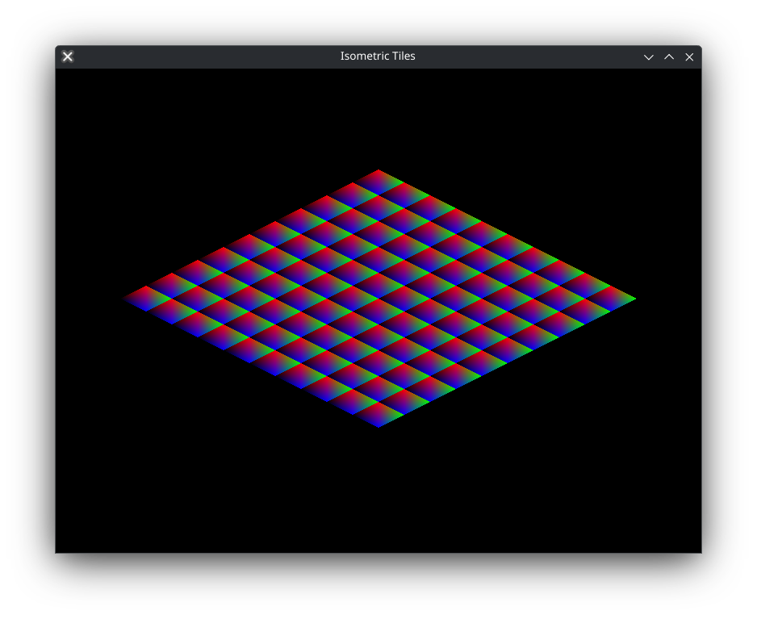

# Isometric Tiles

This project is a simple isometric "game" made with C and the SDL3 library.

## Dependencies
- `libsdl3-dev` 
- `libsdl3-image-dev` 
- `CMake 3.31` or above
- `GCC` or your preferred C compiler

## Build
```bash
cmake -S . -B build
cmake --build build
```
## Run
```bash
./build/isometric
```

